# The hub

The hub is the brain's start page: a start screen, then a status strip, module buttons (Teleop, Monitor, AI Control, Training), the assistant, and panels of real project facts. It has two looks:
- **plain** (`/plain`, and `/` by default): simple on purpose. It has the same parts and names as the approved design, without its looks.
- **designed** (`/design`): the approved design (`docs/design/hub-concept.html`), built since 2026-11-10. This is the one that we show (below: "The designed hub").

`hub.look` in `config/theme.yaml` (`plain` or `design`, or ⚙ → The Lab → The Main Address Shows) selects which look `/` shows.

## Start it
```bash
uv run lab-os serve                    # the hub, the teleop pages and the arm plugged in (else the fake arm)
```
Then open **http://localhost:8080/** in a browser on the same computer. In VS Code: Run and Debug → "Hub: lab-os serve (fake arm)".

| Address | What |
|---|---|
| `/` | the hub, in the look that `hub.look` selects. Add `#skip` to go past the start screen. |
| `/design`, `/plain` | each look by name |
| `/ai` | AI Control: what an AI tool does with the arm (below) |
| `/settings` | the settings (also the ⚙ in the hub's strip) |
| `/xr` | the hub in VR or AR for the Quest (`docs/guides/quest-setup.md` → "The hub in VR"). On another computer, "Preview on this screen" shows it (drag to look around, click to press). The designed hub's strip shows a headset button where VR works. |
| `/training` | start the SO-101 training setup (green arms and LeLab) after a port check, on the brain's computer (`docs/guides/green-launcher.md`) |
| `/teleop` | the teleop page (the Quest opens this one with `lab-os serve`; `lab-os-teleop` shows it at `/`) |
| `/monitor` | the arm monitor |
| `/webcam` | teleop with a webcam (preview): your bare hand in front of a webcam drives the arm, on the brain's computer (`docs/guides/webcam-teleop.md`) |
| `/classic/teleop`, `/classic/monitor` | the plain teleop and monitor pages from before the design, kept in case the new ones break |
| `/perf` | the performance test (below) |

**Options** (the same as `lab-os-teleop`'s):
- `--arm` (for example `fake`, `fake-xarm1`, `so101-white`). Without `--arm`, the brain drives the SO-101s that are plugged in when it starts: one arm, or two arms as `--arm` and `--left-arm`. It never takes the green set by itself, because LeLab or a training run may need it: name it with `--arm so101-green`. With no arm plugged in, it drives the fake arm. When a plugged-in arm cannot open (another program has its port, or it has no calibration), the brain says why and drives the fake arm. When it drives the fake arm this way, it takes an SO-101 that you plug in later, with the same rules: only while nobody drives the fake arm (for 5 seconds), and the pages then show the new arm. `--arm fake` always drives the fake arm. An unplugged SO-101 or xArm freezes, every page says "disconnected", and it connects again by itself when you plug it back in.
- `--venue visit-day`, `--port 8090`, `--config <folder>` (another place: `docs/dev/places.md`).
- `--mcp-port`: the robot tools for AI (`docs/guides/ai-control.md`).
- `--persona` (`docs/dev/personas.md`).
- `--open desk`: open the hub on this computer as that device when the brain runs ("Devices" below).
- `--status-line`: show teleop's live status line under the log. It is off by default for `lab-os serve`, because the hub shows the state. `lab-os-teleop` shows it unless you add `--quiet`.
- `--host 0.0.0.0`: other computers can open the hub. With a real arm, they only watch (and their STOP works). `--drive-from pi01.iwu.ai.lab` (you can use it more than once) lets that computer drive too.

**The terminal** (since 2026-11-19): each log line starts with the time ("12:04:31 INFO …"). In a terminal, warnings are amber and errors are red. The other lines stay plain. In a pipe or a log file, there is no colour. To switch the colours off, set `NO_COLOR=1` (no-color.org).

In a coding session, ask the builder before a real arm moves (`SAFETY.md`, `AGENTS.md`).

## The start screen
**The plain hub has two taps,** because browsers allow full screen and sound only after a press:
1. **Tap 1, full screen** ("Tap for full screen"): the builder taps when leaving the hub on a screen. The page skips it when it is already full screen (kiosk mode, F11, an installed app) or when the browser cannot do it.
2. **Tap 2, start** ("Tap, click or press any key to start"): the visitor's tap. It opens the hub.

If the plain hub leaves full screen (a swipe, holding Esc, a reload), the start screen with tap 1 comes back.

**The designed hub has one tap:** full screen, the unlock and the startup (about 8 s; any input skips it). Leaving full screen does not bring back the start screen.

**A card swipe starts it too** (quick job 79). Plug the lab's USB card reader into the computer that shows the hub, and swipe a student ID on the start screen. The hub starts with its own, faster unlock and sound ("Card read"), then the normal startup. Only a card whose data is a plain number starts it. Other cards (for example a bank card) do nothing. The hub uses the card's data only to see that a card was swiped. It never keeps, logs or sends it. A key that a person presses still starts the hub as before.

**No long-press menu:** on a touch screen, a long press on a hub page does not open the browser's menu (Inspect, Save image). In the ask line, a long press still selects text, and paste works. A mouse's right click still opens the menu.

**The Full screen button** is on every page (the hubs' status strips, the bar of each module page, the classic pages, `/perf`), while the page is not full screen (also after F11, and in the window that "Start lab-os" opens). It does what tap 1 does. If the browser cannot go full screen, the button stays, and when you press it, it **says why** (also in its tooltip). The reasons: no Fullscreen API; the browser switched it off (for example a kiosk or a managed policy); a permissions policy blocks it; or the browser refuses it with its own words. Then use the browser's own full screen (F11; Ctrl+Cmd+F on a Mac). One file does this for every page: `src/lab_os/web/fullscreen.js`.

**Modules open inside the hub,** so the page stays full screen. **Back** or **Esc** closes them. In Chrome and Edge, Esc means Back without leaving full screen (Keyboard Lock; hold Esc to leave full screen). In Firefox (and Chromium browsers without the lock), Esc also leaves full screen; the next tap or key then goes full screen again. Leaving on purpose (F11, or Esc with nothing open) stays left. In teleop's desktop control, the first Esc leaves desktop control and the next one is Back.

**Back to the start screen:** after `hub.reset_after_s` (30 minutes) with no input, the hub goes back to the start screen, still full screen, so the next person needs only one tap. It also starts a new conversation (bring back the last one with ↶, below). A venue can set its own `reset_after_s`. Both timers are in ⚙ → The Lab. It never goes back while something is in use: a teleop page (the hub's or the Quest's) has the arm, an AI tool moves it, a chat answer comes in, or a voice turn runs.

**Sleep (designed hub):** after `motion.idle.sleep_after_s` (15 minutes) it dims to the network and the breathing core. Any input wakes it. Sleep shows only when it is shorter than the time to the start screen.

## Asking the assistant
Type anywhere on the hub: the letters go to "Ask anything" under the core. Press Enter. **History** opens the full conversation. Keys, AI setups and the budget: `docs/dev/chat.md`.

**Voice:** hold the mic button next to it (or Space) and talk; the answer is spoken. Each screen can also use dictation or the wake word (⚙ → This Device → Talking to It). The mic shows only on a secure page with a microphone (`docs/guides/voice.md`).

**Bring back the last conversation:** the small amber ↶ in the ask line (hover over it: how many questions, and when), or a line at the top of **History**.

**Asking it to show something:** ask, typed or by voice: "pull up the teleop page", "show me the AI spend", "open the settings", "go back to the hub". It opens that page **on the screen that you asked** and says so in a few words ("Here's Teleop."). It knows what each screen can show: the module buttons, Settings, the panels' pages (designed hub), the conversation. Details: `docs/dev/chat.md` → "It opens pages".

**The core on an open page:** while a module or a panel's page is open, the core is small in the bottom right corner. It still works: **hold it to talk** (like the mic). What it hears and says shows next to it for a while. With the wake word on, "hey Jarvis" also works with a page open, so "hey Jarvis, go back to the hub" works without hands.

## The designed hub (`/design`)
The design's look, motion and sound, on the brain's real facts:
- The title is the place's name. The strip shows the venue, the persona, the internet and the AI setup.
- The panels show the current focus (with its steps), the AI spend, the commits (with the latest few) and the devices from `devices.yaml`.
- The log at the bottom shows the latest commits and the current step.
- The startup's checks (theme, sound, display, internet, AI, assistant, arm) say what really happened. The greeting is the brain's.

**The strip's tools** (top right, after the clock): **⏻** goes back to the start screen now. **⚙** opens Settings. On the brain's own computer, ⏻ opens a small menu instead: **Back to the start screen**, or **Shut down lab-os**.

**Shut down lab-os** (⏻ on the brain's computer, or ⚙ → Safety Limits and Shut Down): it asks first. The first line of the question names each arm that goes limp (an SO-101: put it down or hold it), and the **Shut down** button names it again. Then it stops any move and tells every page. From that moment, nothing moves: the brain refuses every AI tool move, the wave and teleop input. It never switches the motors on again. In about one second, the brain stops as Ctrl+C in its terminal does: it lets go of the arm and the microphones close. Every page then says **lab-os is off** (who shut it down and when). On the brain's computer, the hub window that "Start lab-os" opened closes, and so does the Quest view window. On another device, the browser closes the page if it allows it; if not, the page says **lab-os is off**. **Ctrl+C** in the brain's terminal does the same as Shut down. In the headset, the VR and AR hub shows the same words on a card in front of you, and the teleop status panel says "lab-os is off". If the hub in VR gets no answer from the brain (for example when the network fails), its card says **lab-os is not reachable**, and nothing starts. Point at **EXIT** under the card to go back to the browser. The pages come back by themselves when the brain runs again (the "Start lab-os" icon). Only the brain's computer can do it, on any venue (a person is always there).

**Answers show at a steady speed** (about 125 characters a second; the AI sends text in pieces, and the page sets the pace). They go faster only when the page is far behind. At the `minimal` level of detail, each piece shows at once.

**A slow screen** (for example Firefox on Linux, which often draws without the graphics card): the hyperspace jump removes stars until it runs at about 40 frames a second (not below about 1000 stars). The `reduced` level starts with half of the theme's `stars`.

**Startup as a video** (since 2026-11-18; a test for screens where the startup stutters; in the lab 2026-11-19 it was a little smoother, but its resolution is lower and the stars do not match when it changes to the live hub, so it stays off): ⚙ → This Device → **Startup as a Video**, off by default.
- From the start press until the core arrives (about 6.9 s), the hub plays a recording (`src/lab_os/hub/web/media/startup-full.webm` or `startup-maximal.webm`, the one that matches the device's level of detail; 1920×1080, 60 frames a second). The words and the sounds stay live above it.
- Then the live hub fades in over half a second (the core's rings can look doubled for that moment).
- It plays only for the hyperspace startup at `full` or `maximal` detail, on a screen with the recording's shape, with the theme that it was recorded with (the `.json` next to each video). If not, the hub draws the startup as usual, and the browser console says why.
- **The design stays the source.** After any change to the startup, record both again with `scripts/record_startup.py --quality full` and `--quality maximal` (it needs Chrome and ffmpeg; its first lines say how). A test fails while the theme and the recording are different. `--compare out.mp4` shows the live and the video startup side by side.

**In the address:** `?quality=` (`maximal`, the theme's default since 2026-11-18, adds the far-layer verses; `full`, `reduced`, `minimal`), `?startup=assemble` (instead of `hyperspace`), `?sound=0`, `?full=0` (do not go full screen, for a laptop), `?res=0.5` (the drawing resolution, below), `#skip`. For example: `http://localhost:8080/design?quality=full`.

**Drawing resolution** (for slow screens such as the Newline): how many pixels the moving pictures use before the screen scales them up.
- `auto` (the default): the screen's own, up to 2× (a 4K panel at 2× draws 3840×2160 pixels in each frame).
- `1`: one per CSS pixel (a quarter of that on such a screen). `0.75`. `0.5`: a sixteenth (soft, but very light).
- It applies to the network and hyperspace, the effects layer, the arm drawings in modules, and the 3D arm in teleop, monitor and AI Control's side view. Text, the core and the frame do not change (they are not canvases).
- Set it for each device in ⚙ → This Device (the brain keeps it under the device's name), or in the address: `?res=` wins (also for the pages that open inside the hub). The numbers are the same as for `/perf?res=`, so a number that runs smoothly there is the one to use. The browser console says `hub: drawing at 1× (1920×1080 for 1920×1080)`.

**System diagram** (2026-11-18, quick job 12): the network icon next to **List all** in the Devices panel opens it in full screen, like a details page.
- The brain is the core in the middle. The screens are on the left (lit with the hub open, gray if listed but not open; this screen in brackets), with an AI tool (MCP) below them. The cameras and arms are on the right (lit: the arm that the brain drives), with LeLab below a borrowed arm. The AI service is above. The brain's parts are in the order that a move goes through them.
- The line's style shows the kind of link (USB solid, network dashed, MCP dotted, internet long dashes). Only real links carry pulses.
- It shows how things connect, not every device (no leader arms; the cameras as one). It is drawn from the same facts as the panels each time (`devices.yaml`, the devices with the hub open, the AI setup), so another place or a new arm shows what it has. The names are as people say them (`so101-white` → SO-101 White). The code: `src/lab_os/hub/web/system-diagram.js`. A copy for the docs comes from a running brain with `scripts/save_system_diagram.py` (its first lines say how):

  

**Not real yet, so not shown:** whether a robot or camera is switched on (the roll call needs the lab router; the Devices panel's Power column says "not known"), and alerts (no real alert source yet). The Devices panel shows the place's `devices.yaml` (robots, cameras). The devices with the hub open are in "Open on…" (below).

**The code:** one file, `src/lab_os/hub/web/design.html`: the design's CSS, SVG and JavaScript, with the brain's endpoints instead of the made-up data. The fonts are in `src/lab_os/web/vendor/fonts/` (offline).

## AI Spend: what it counts (2026-11-19, quick job 41)
The AI Spend panel shows "Estimated · this computer's brain only" under the total. The plain hub, the designed hub and the VR hub show the same words.
- **Estimated:** lab-os calculates the cost itself. It does not get the bill from OpenAI. For chat, it multiplies the token counts that the AI service sends back by the prices in `config/models.yaml`. Somebody types these prices in by hand, so they can be out of date. For voice, it multiplies the seconds that lab-os measured by a price per minute.
- **Less exact entries:** voice, and chat answers where the service sent no token counts (lab-os then counts about 4 characters per token). The spend log marks these entries `estimated: true`. The panel's page says how much of the total they are.
- **This computer's brain only:** each brain writes its own spend log. The total counts every screen of this brain (the desk, the Newline, the Quest). It does not count another brain (for example the laptop) that uses the same OpenAI key. The monthly budget also uses only this brain's total.
- When you ask the assistant how much the AI has cost, it says that the number is estimated.

**The real cost from OpenAI (not built):** OpenAI's costs endpoint (`/v1/organization/costs`) gives the real cost of all brains on one key. It does not accept a normal project key. It needs an **Admin key** (`sk-admin-…`). Only an Organization Owner can make one. To get one, the professor does these steps:
1. Sign in to platform.openai.com as an Organization Owner.
2. Open Settings → Organization → Admin keys (`platform.openai.com/settings/organization/admin-keys`).
3. Select **Create new Admin key** and set the permissions to **Read only**.
4. Give the key to the builder for `.env`.

An Admin key can read the costs of all projects in the organization. With a key, a later session can add the check (off by default) and show "from OpenAI" in place of "estimated".

## Visitor mode: "hey Jarvis, it's demo time" (2026-11-18, quick job 35)
On the brain's own screen, tell the assistant that visitors are here, typed or by voice, in any words: "hey Jarvis, it's demo time", "say hello to our visitors", "we have guests". The AI decides; there are no fixed phrases. Its tool to start visitor mode does three things:
- It switches the running brain to the place's venue for visitors (the one with `visitors: true`: `visit-day` in the lab). That venue has the lab's robots, speed and 1:1, and its limits can be switched off as in the lab (the builder, 2026-11-18: no extra restrictions for visitors). The hub hides Settings (⚙ shows only **Visitor Mode**) and the AI spend.
- It gives the assistant facts for a short welcome. The assistant says the welcome in its own words. The facts are the place's name, what the place is (`about:` in `place.yaml`), and the robot arms that are really plugged in now: the arm that the brain drives, and any other arm whose USB port is there. If no arm is plugged in, the welcome does not mention robots. A typed welcome is also spoken.
- It shows the venue's **"try this" cards** above the core (`try_this:` in the venue file). Tapping a card that asks something asks it, as if you said it. In the lab: "Ask me to wave" and "Open the VR hub" (in the headset's browser, the assistant opens the VR hub when asked). "What's on the table?" is in the file but off until that preview exists.

**The wave** (only in visitor mode): ask the assistant to wave, in any words. The arm goes to `ready` and plays a fixed wave from `config/gestures.yaml` (the shoulder turns 8°, the wrist nods 15°, two times), at the venue's speed. The AI decides to wave; it never chooses the motion. The soft joint limits, the floor, STOP and one controller at a time apply, as for every move. While teleop drives the arm or another move runs, the assistant says that it cannot wave. AI Control shows the wave like a tool call.

**Exit visitor mode:** ask the assistant ("exit visitor mode", "the visitors have left", "the demo is over"), or select ⚙ → **Exit Visitor Mode**. The brain goes back to the venue that it started with. A restart does that too: nothing saves the switch. **Without asking:** ⚙ → The Lab → **Start Visitor Mode** switches it on (with no welcome).

The assistant gets these tools only for a question asked on the brain's own computer (or the Quest on its USB cable). The ⚙ buttons work only there too. The brain refuses the switch if the arm that it drives is not in the visitors' venue's `active_devices`.

## The assistant moves the arm: "hand me the cube" (preview, 2026-11-20)
**It is off by default.** To turn it on, set ⚙ → Robots → **The Assistant May Move the Arm** (`assistant_moves_arm: true` in `place.yaml`). It then works in every venue, visitor mode too, but never in a venue with `public: true`. It applies from the next question, with no restart.

When it is on, ask the assistant on the brain's own computer, typed or by voice, in any words:
- **"Hey Jarvis, move the arm to home."** The arm goes to a named pose: `home` (folded), `ready` (the working pose) or `handover` (held out to a person).
- **"Jarvis, hand me the cube."** The brain takes a picture with the stand camera and finds the blue cube by its colour. The arm picks the cube up and holds it out to you at the `handover` pose, about 28 cm in front of the base and 20 cm up. This takes about half a minute.
- **"Let go."** (or "I have it", "open"): the gripper opens.

The AI decides when to use these tools; it never chooses the motion. Each move is a robot tool call, with the same checks as an AI tool's move (`docs/guides/ai-control.md` → "Limits"), at the venue's speed. AI Control (`/ai`) shows each call. STOP on any page stops the move, and the rest of the request ends. While teleop drives the arm or another move runs, the assistant says that the arm cannot move now.

For the cube:
- Put the cube about 20 cm straight in front of the arm. The arm picks straight down, and that works only in a ring about 17 to 22 cm from its base. If the cube is out of reach, or the camera cannot see it, nothing moves and the assistant says why.
- The stand camera needs its table map (`docs/guides/ai-control.md` → "Table map").
- The colour, the cube's height and the hand-over pose are in `config/handover.yaml`. The `handover` pose is in `config/poses.yaml`; it was computed on the arm's 3D model.
- Questions from other screens never get these tools.

## The module pages (Teleop, Monitor, AI Control)
They have the hub's design (`src/lab_os/web/design/`: `kit.css`, `kit.js`, `icons.svg`, shared by every module page). Inside the hub, they have no frame or title of their own. On their own screen, they have both, the place's name, the clock and a choice: **Full screen** while the page is a window, **Window** while it is full screen. Select **Window** to put several pages on one monitor. The browser keeps the choice for each page. The core page (the hub) has no **Window** button: it is always full screen.
- **Teleop** (`/teleop`): the arm in 3D on the left. On the right: how to drive it (the Quest's Enter AR or VR, Desktop control and its keys) and what the page sends. The status (brain, control, arm) and **STOP** are in the bar, always in view. While desktop control is on, its button says "Desktop control on", and "X = STOP" shows next to STOP (X stops in every mode). **Controls**, beside it, shows the mode and the keys (it opens by itself when desktop control starts). When another page drives the arm, or the AI tools do, the buttons that would take control are grey, and a line under them says who has control ("The page on desk has control. It must stop first."). A screen that may only watch says "View only". The Webcam control page does the same with its Start button.
- **Monitor** (`/monitor`): for a screen that people watch: the arm in 3D, a gauge for each joint, STOP. It only watches; it never drives.
- **AI Control** (`/ai`): what an AI tool (Claude Code, Codex, and others) does with the arm, live. It shows the arm from its side with its real geometry (from the arm's kinematics, in cm), and where the last `move_to` aimed. It lists each robot-tool call as it happens (ok, clipped, refused, stopped, error), with the result. It shows if the tools are on and moves are allowed, and STOP. Until the first call, it says how to connect Claude Code. It never moves anything.
- **The old pages** stay at `/classic/teleop` and `/classic/monitor` (the same scripts, the old look), in case the new ones break somewhere (for example in the Quest's browser).

## What the Quest sees
On the brain's own computer, a button in the strip (the screen-with-goggles icon; **Quest view** on the plain hub) opens a window with what the Quest on the USB cable sees, so that the room can watch. It needs scrcpy: `docs/guides/quest-view.md`.

## Settings (the ⚙, or `/settings`)
The ⚙ in either hub opens this page. Since 2026-11-19 (quick job 38), it follows common guidance for settings screens (Apple's Human Interface Guidelines, Nielsen Norman Group):
- **Grouped by what a setting affects, the most-used first:** This Device, Assistant, The Lab, Robots. A sidebar on the left goes to a group. Each group's heading folds the group (the page remembers which groups are folded).
- **Each row** shows its label, a short help line only where the setting is not obvious, and its **current value on the right**. All values end at the same edge, with the unit after them. **"✓ Saved"** shows for a moment after a change. A problem shows as a sentence under the row.
- **Restart Now:** settings that apply only after a restart (the robot and safety settings, the wake word, how long to keep conversations) collect in an amber bar at the top, with **Restart Now**. It asks first, and warns when an SO-101 would go limp. The brain stops as for "Shut down", then starts again by itself with the same options. Every page comes back by itself. The row of each such setting also says "Applies when the brain restarts". When you set a value back to what the brain runs with, it leaves the bar (quick job 45). A change saves at once, as in GNOME's and Apple's settings: there is no OK or Cancel. To undo a change, set the old value again. The bar stays when you close ⚙, and every window of ⚙ shows the same bar.
- **A settings file that can't be read** (for example after an edit by hand): a red box at the top names the file and the line, and says what to do. A change then says the same instead of saving. If **Restart Now** does not bring lab-os back within 45 s, the page says to look at the brain's terminal.
- **Apart, at the bottom, with a red edge: "Safety Limits and Shut Down."** The switches for the AI tools' limit for each move, the speed cap and the floor (on by default). A limit that is off shows "(Off)" and is listed in the bar at the top. A public venue or a venue with `limits_locked: true` cannot switch them off. Then what always stays (STOP, the soft joint limits, one controller at a time), and **Shut Down lab-os**.
- **This Device:** level of detail, sound, how to talk to it and the wake word's sensitivity, the assistant's languages, full screen on the start press. Then, for slow screens and other monitors: drawing resolution, the startup as a video, the monitors of this computer, the device's "Lab Hub" icon. The brain keeps these under the device's name ("Devices" below), so the Newline can run Full while a Pi runs Minimal. Each device can change its own.
- **The Lab** starts with **Visitor Mode** (Start or Exit; "Visitor mode" above). While it is on, every other setting, This Device included, is hidden and cannot be changed.
- **Saved for this place only:** the page saves a change as soon as you make it. It writes only the changed value, into the place's `local/` folder: `config/local/theme.yaml`, `config/local/place.yaml` or `config/local/venues/<venue>.yaml` in the lab. Git ignores that folder. To go back to the default, delete the line there. To change the default for every place, edit the file in `config/` and commit it (`docs/dev/places.md` → "The place's own changes").
- **Only on the brain's computer:** other screens show the settings but cannot change them (a hallway screen must not rename the lab or switch robots on).
- **For new modules:** the page shows what `src/lab_os/settings.py` lists, in its groups. A setting is one `Field` (file, path, label in Title Case, kind: choice, bool, number, text, color or list, and an optional `default` that shows when the file has no value). A new module adds its own group with `settings.register(Section(...))`. The page needs no change.

## Other monitors on the brain's computer (HDMI, DisplayPort)
Monitors connected to the brain's computer are more screens of the same browser, so any page can go there:
- **From the hub (designed hub):** open the module (Teleop, Monitor, AI Control, …), press **Open on…** next to Back, then **Another monitor of this computer**. In Chrome on that computer, the page opens on the other monitor (Chrome asks once to allow "window management"; it needs `localhost`, which the brain's own screen is). On the brain's computer, in the hub window that "Start lab-os" opened, the new page goes full screen by itself, and the hub stays full screen. Elsewhere, click the new page for full screen. If **Window** was selected on that page before, it stays a window. The hub closes its copy. Without that permission, or in another browser, it opens a window that you drag to the monitor. ⚙ → This Device → "Monitors on This Computer" gives the permission in advance and lists the monitors (then other devices' "Open on…" lists name the monitors).
- **A second hub on that monitor:** open the hub there too, with the same name (`/design?device=desk`). Then the device has two windows, and other devices' "Open on…" offers both ("Devices" below).
- **By hand:** open `http://localhost:8080/monitor` in a new window, drag it to the monitor, and press F11 (or the page's Full screen button). Or, from a terminal, open an app window at that monitor's position (here, a second monitor 1920 pixels wide, to the right):
  ```bash
  google-chrome --new-window --app=http://localhost:8080/monitor --window-position=1920,0 --start-fullscreen
  ```
- Any page works this way: `/monitor`, `/ai`, `/teleop`, `/design` (a second hub), `/settings`.
- **The Newline on an HDMI cable and its USB touch cable** to the brain's computer is the same: one more monitor (with touch). It is `localhost`, so voice also works there.

## Devices (step 8): named devices, "Open on…", one tap each
A **device** is a computer or screen with the hub open under a name in its address: `/?device=desk`, `/?device=newline`, `/?device=quest-a` (lowercase letters, digits and dashes). The brain keeps the list of the devices that have the hub open now, and nothing else about them.
- **The name** stays in the address (a reload keeps it), and the browser remembers it: the next time it opens `/` without a name, it is that device again. `?device=` with nothing after it opens the hub with no name.
- **This Device** (⚙): the brain keeps the device's settings under its name, in the place's `local/hub-devices.yaml` ("Settings" above).
- **A device's monitors:** each monitor with the hub open is a window of the device (for example the desk's two monitors, each with `/design?device=desk`). Other devices' "Open on…" opens on the free monitor (nothing open there). When two are free, or none, it asks which ("left monitor", "right monitor", or the monitor's own name after ⚙ → This Device → "Monitors on This Computer" was allowed).
- **Open on…** (next to Back in an open module, in both looks) lists the other devices with the hub open and what each shows, and this device's other monitors. Select one: the page opens **inside that device's hub**, as if someone pressed the button there. This also works from its start screen, with no startup and no new conversation. A module that is open there gives way only if you selected that monitor. This hub closes its copy, so a teleop page never has two connections. The page there says "Opened from <device>".
- **To close it:** press **Back** there, or **Bring it back** here (a line at the top of the hub, "Monitor is on desk"). It closes there and opens here again.
- **Only devices with the hub open are listed,** so the hub never takes over a device that does something else (the Newline showing a slide). The menu opens on the left, so it never covers a page's STOP.
- **When the brain restarts,** every hub page connects again by itself within a few seconds and tells the brain again what it shows. "Bring it back" still works after that. (A page opened while the brain was off does not load: tap the icon again when the brain runs.)
- **Who can:** any hub page can open a page on another device that has the hub open (it only changes what that screen shows; a real arm's teleop page on another computer still only watches).
- The Quest's VR hub (`/xr`) is not a device yet. To list the Quest, open `/design?device=quest-a` (or `quest-b`, `quest-c`: `config/devices.yaml`) in its browser.

**One tap for each device** (nothing starts by itself):
- **The brain's computer: "Start lab-os".** Make the icon once, in `~/lab-os`:
  ```bash
  uv run lab-os icon --device desk
  ```
  The brain then drives the arm that is plugged in, else the fake arm ("Start it" → `--arm`). To always start with one arm, add it after `--`, for example `uv run lab-os icon --device desk -- --arm fake`.
  The icon is in Ubuntu's app list (right-click → Add to Favorites puts it in the dock). It opens a terminal that runs `lab-os serve --open desk --host 0.0.0.0 …` (the brain's log; Ctrl+C stops the brain). When the brain runs, it opens the hub as `desk`, and the start press makes it full screen (Chrome's app window; any Chromium browser, else the default browser). If the brain already runs, the icon brings the hub window to the front. It opens a new hub window only when none is open. The hub window is a browser of its own, with its own settings folder (`~/.cache/lab-os/hub-browser`). Allow the microphone in it once. On macOS or Windows, `lab-os icon` shows the command for a shortcut. The look that it opens: `hub.look` (⚙ → The Lab). `--host 0.0.0.0` lets the other devices connect; with a real arm, they only watch (and their STOP works).
- **Other computers: a "Lab hub" icon.** Open the hub there once at the brain's address with the device's name (`http://<brain's IP address>:8080/?device=newline`). Then select ⚙ → This Device → **"Lab Hub" Icon**. Select the Linux icon (`.desktop`) or the Windows icon (`.bat`); it has the brain's address and the name in it. Put the Linux icon in `~/.local/share/applications/` or on the desktop, and allow launching. By hand, it is the same as this command:
  ```bash
  google-chrome --app=http://<brain's IP address>:8080/?device=pi01 --start-fullscreen
  ```
  (`chromium` on a Pi.) The brain's address is the desktop's IP address for now: when it changes, make the icon again.
- **The Newline (Android) or a tablet:** in Chrome, open `http://<brain's IP address>:8080/?device=newline`, then ⋮ → **Add to Home screen**. On `http://` it opens as a normal tab: tap once for full screen.

## Full screen without a tap (kiosk)
A page can go full screen only after a press (the browsers' rule, also on `http://`). To skip even that, open the browser already in full screen:
- **A Linux or Windows desktop (Chrome, Chromium):** an app window in full screen that closes like any window:
  ```bash
  google-chrome --app=http://localhost:8080/design --start-fullscreen
  ```
  (`chromium` instead of `google-chrome` on a Pi; another screen uses the brain's address instead of `localhost`.) `--kiosk` instead of `--start-fullscreen` also hides the way out (Alt+F4 still closes it). Use it only on screens that nobody needs for anything else.
- **The Newline (Android):** Chrome's menu → **Add to Home screen** gives an icon. On `http://` it opens as a normal tab (an installed full-screen app needs a secure address), so tap once for full screen. What the Newline allows: `docs/plan/ideas.md` → "Screens without browser bars".

## Other screens (the Newline, a hallway desktop)
`lab-os serve` listens on this computer only. To show the hub on another screen:
- **The screen is this computer's display** (HDMI and USB touch): open `http://localhost:8080/`. Everything works.
- **Over the network:** run `uv run lab-os serve --host 0.0.0.0` and open `http://<this computer's IP address>:8080/?device=<its name>` (or `/design?device=…`) on the screen ("Devices" above: the name lists the screen and keeps its settings). To find the address, run `hostname -I` (Linux; the first one) or `ipconfig getifaddr en0` (macOS). The screen must be able to connect to this computer: some networks block devices from each other (`docs/guides/network-setup-checklist.md` → "Networks before the router").
  - **With a real arm** (`--arm so101-white`), other screens **only watch.** They show the hub, the arm and the monitor, and their **STOP works**. But the brain ignores their teleop input ("view only: the arm is driven from the brain's computer"). Only this computer drives: its own browser, the AI tools (MCP, this computer only), and the Quest over `adb reverse` (it arrives as this computer).
  - **Not a secure page** (`http://` and an address): Esc leaves full screen (no Keyboard Lock), the screen can sleep (no Wake Lock), and Copy and voice do not work. Full screen itself works. The ways around it (Chrome's flag, `adb reverse`): `docs/guides/voice.md` → "Secure pages".

## Performance test (`/perf`)
It draws moving dots that link when they are near, and star streaks that speed up from the middle, in the same way as the design's network and hyperspace, in plain gray. It shows the frames per second (the last second, the average over 10 s, the slowest frame) and the canvas size. The settings (what to draw, dots per million pixels, stars, resolution) are in the address, for example `/perf?draw=net&density=90&stars=3000&res=2`, so that you can bookmark each screen's test. Run it in full screen on each screen for a minute and write down the average. 55 to 60 frames a second can carry `full`; lower numbers need `reduced` or `minimal` (DESIGN.md → "Quality levels").

## Where the code is
- `src/lab_os/cli.py`: `lab-os serve`.
- `src/lab_os/hub/`: `server.py` (the pages, the `/api/…` endpoints, the module list, the assistant's state, the look), `hub_devices.py` (the devices with the hub open, "Open on…", each device's settings), `launch.py` (`--open`, the "Start lab-os" icon), `visitors.py` (visitor mode), `project.py` (the Steps list), `commits.py` (`git log`: for each day, and the latest few), `internet.py` (the internet check).
- `src/lab_os/hub/web/`: `index.html`, `hub.js`, `hub.css` (the plain hub), `design.html` (the designed hub), `system-diagram.js`, `ai.html` and `ai.js` (AI Control), `settings.html` and `settings.js`, `perf.html` and `perf.js`.
- `src/lab_os/settings.py`: what the settings page shows, and how it checks and writes the values.
- `src/lab_os/teleop/web/`: `index.html` (teleop), `monitor.html`, `pages.css`, their scripts, `classic/` (the old pages).
- `src/lab_os/web/design/`: the module pages' shared look (`kit.css`, `kit.js`, `icons.svg`).
- `src/lab_os/web/`: files that every page uses (the libraries, `theme.js`, `device.js`: this page's device name, its settings, the hub's connection, the "Open on…" lists; `off.js`: the "lab-os is off" screen).
- The endpoints: `docs/dev/protocol.md` → "HTTP endpoints".
